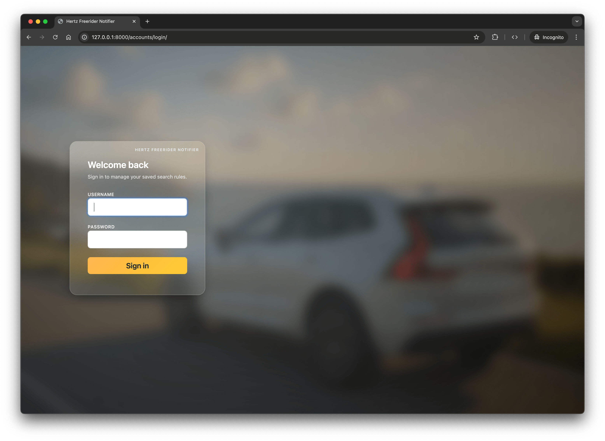
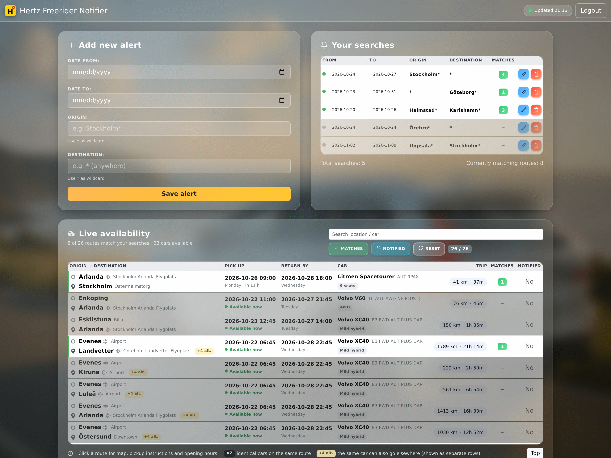
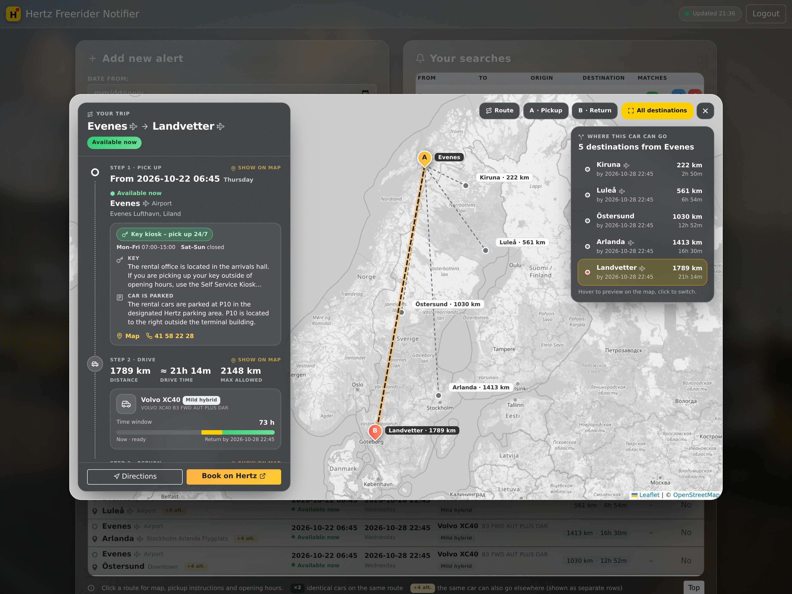
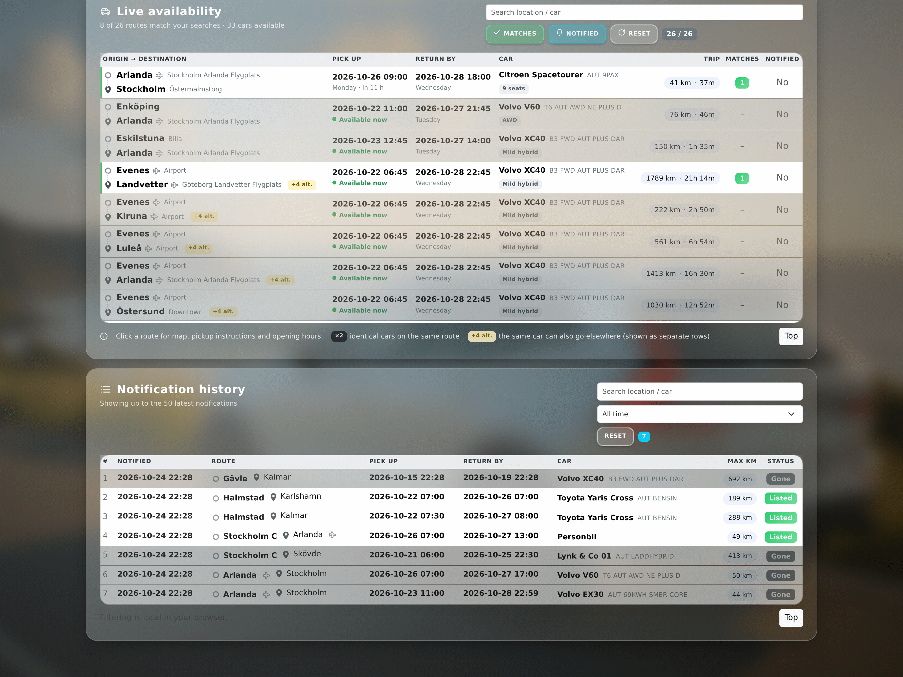
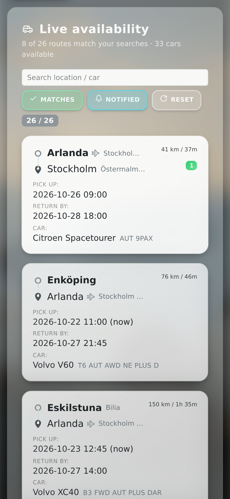
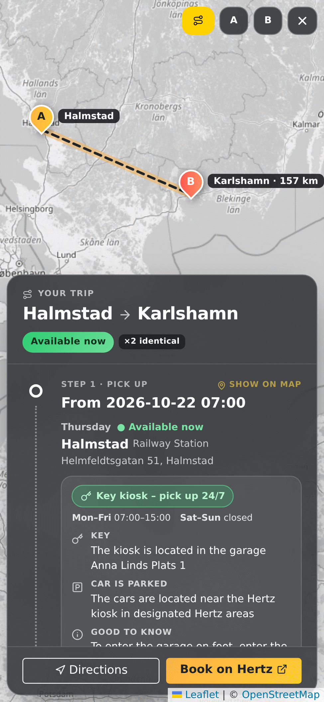
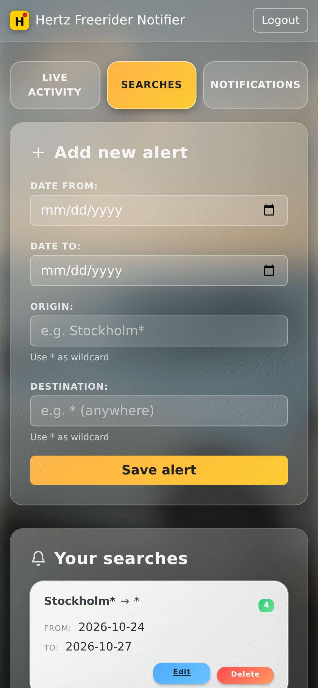

# Hertz Freerider Notifier

A Django & Celery app that watches [Hertz Freerider](https://www.hertzfreerider.se/) every 2 minutes and sends a Pushover alert when a car matching one of your saved searches becomes available.

## Features

* **Saved searches** with origin, destination and dates (`*` as wildcard).
* **Notifications** with the car, the full station names, times, distance and a map of the route. Identical cars on the same route share one notification.
* **Live availability** of all current routes: pickup and return times, car model with full fleet code, distance and matches.
* **Route details** on a map, with the trip as three steps (pick up, drive, return) and every destination the same car can go to.
* **All routes on a map** via the Map button. Pick a route to see its steps.
* **Notification history** and a mobile-friendly layout.
* **Dockerized:** PostgreSQL, Redis, Celery worker & beat.

## Screenshots

### Desktop
<p align="center">
   <a href="docs/img/screenshot_login.png" target="_blank" title="Login"></a>
   <a href="docs/img/screenshot_dashboard_01.png" target="_blank" title="Searches & live availability"></a>
   <a href="docs/img/screenshot_details.png" target="_blank" title="Route details"></a>
   <a href="docs/img/screenshot_dashboard_02.png" target="_blank" title="Notification history"></a>
</p>
<p align="center" style="margin-top:-6px;">
   <sub><strong>Left → Right:</strong> Login · Searches + Live availability · Route details · Notification history</sub>
</p>

### Mobile
<p align="center">
   <a href="docs/img/screenshot_mobile_01.png" target="_blank" title="Live availability"></a>
   <a href="docs/img/screenshot_mobile_details.png" target="_blank" title="Route details"></a>
   <a href="docs/img/screenshot_mobile_02.png" target="_blank" title="Searches"></a>
</p>
<p align="center" style="margin-top:-6px;">
   <sub><strong>Mobile:</strong> Live availability · Route details · Searches</sub>
</p>

## Getting started

Requires Docker with Docker Compose and a Pushover account.

```bash
git clone https://github.com/cr3ation/hertz-freerider-notifier.git
cd hertz-freerider-notifier
cp .env.sample .env      # set SECRET_KEY, DB_PASS, PUSHOVER_USER, PUSHOVER_TOKEN and the admin login
docker compose up --build -d
```

Open <http://localhost:8000> and log in with `DJANGO_SUPERUSER_USERNAME` / `DJANGO_SUPERUSER_PASSWORD` from `.env`. If they are unset, the defaults are `admin` / `admin123`.

## How it works

Celery beat triggers a check every `HERTZ_CHECK_INTERVAL` seconds. The worker fetches all rides from the Hertz Freerider API, keeps them in Redis for the dashboard and compares them with your searches. For each new match it sends a Pushover notification with a map of the route, drawn from [OpenStreetMap](https://www.openstreetmap.org/copyright) tiles. The ride is recorded once Pushover has accepted it, so it is never notified twice, and a failed send is tried again on the next check. A search matches when its origin and destination match the station names (case-insensitive, `*` as wildcard) and its dates overlap the car's pickup–return window.

To trigger a check right away:

```bash
docker compose exec app python manage.py shell -c "from scheduler.tasks import check_hertz; check_hertz.delay()"
```

## Environment variables

| Name | Description | Default |
| ---- | ----------- | ------- |
| `SECRET_KEY` | Django secret key. With `DEBUG=0` the app won't start on the sample value | `changeme` |
| `DEBUG` | Debug mode (0 or 1) | `0` |
| `HERTZ_CHECK_INTERVAL` | Seconds between Hertz checks | `120` |
| `APP_PORT` | Host port for the web app | `8000` |
| `APP_DEBUGPY_PORT` | Host port for debugpy (when `DEBUG=1`) | `5678` |
| `DB_NAME` / `DB_USER` / `DB_PASS` | Database name, user and password | `db` / `devuser` / `changeme` |
| `DB_HOST` / `DB_PORT` | Database host and port | `db` / `5432` |
| `ALLOWED_HOSTS` | Allowed hosts (comma-separated) | `127.0.0.1,localhost` |
| `CSRF_TRUSTED_ORIGINS` | Trusted origins incl. scheme, e.g. `https://example.com` | - |
| `HTTPS` | `1` when the site is only reached through an HTTPS proxy such as Cloudflare: Django trusts the proxy's `X-Forwarded-Proto` and sends cookies over HTTPS only | `0` |
| `SITE_URL` | The dashboard's address, e.g. `https://hertz.example.com`. The notification's button opens the route there; without it, the button opens Hertz's booking page | - |
| `PUSHOVER_USER` / `PUSHOVER_TOKEN` | Pushover user key and app token | - |
| `DJANGO_SUPERUSER_USERNAME` / `DJANGO_SUPERUSER_PASSWORD` | Admin created on first start | `admin` / `admin123` |
| `CELERY_BROKER_URL` | Redis URL for Celery | `redis://redis:6379/0` |
| `REDIS_URL` | Redis for Django's cache: the latest routes and the map tiles | `redis://redis:6379/1` |

## Production notes

* Use `DEBUG=0`. The app then runs on Gunicorn, and static files get hashed names, so browsers never use stale CSS/JS after a deploy. With `DEBUG=1`, do a hard reload after deploying.
* Set `SECRET_KEY` to a long random string (`python -c "import secrets; print(secrets.token_urlsafe(50))"`), change `DB_PASS` and the admin password, and restrict `ALLOWED_HOSTS`. With `DEBUG=0` the app refuses to start while `SECRET_KEY` is `changeme`.
* Behind Cloudflare or another HTTPS proxy, set `HTTPS=1`, and turn on HTTPS redirects and HSTS in the proxy.
* Don't expose the debug ports 5678/5679 from `docker-compose.yml` to the internet.

## Development & troubleshooting

* The source tree is mounted into the containers. After code changes, run `docker compose restart app worker beat`.
* Tests and lint: `pip install -r requirements-dev.txt`, then `pytest` and `ruff check .`. CI runs both, plus `ruff format --check`, on every pull request.
* Front end: plain JavaScript modules in `scheduler/static/scheduler/js/`, with no build step. `dashboard.js` runs the lists and `route/main.js` the route window. The icons are one sprite, `scheduler/static/scheduler/icons.svg`.
* Logs: `docker compose logs -f app worker beat`.
* Debugging: with `DEBUG=1`, attach VS Code ("Python: Remote Attach") to `localhost:5678` (app) or `localhost:5679` (worker).
* Database login errors after changing `DB_PASS`: `docker compose down -v && docker compose up --build -d`. **This deletes all data.**
* Change a password: `docker compose exec app python manage.py changepassword admin`.
